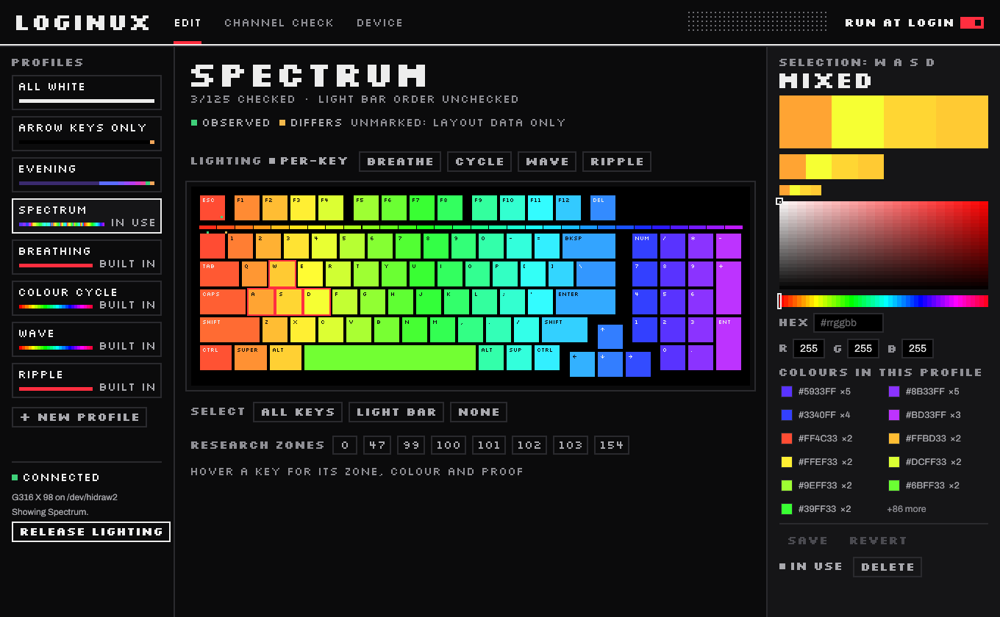
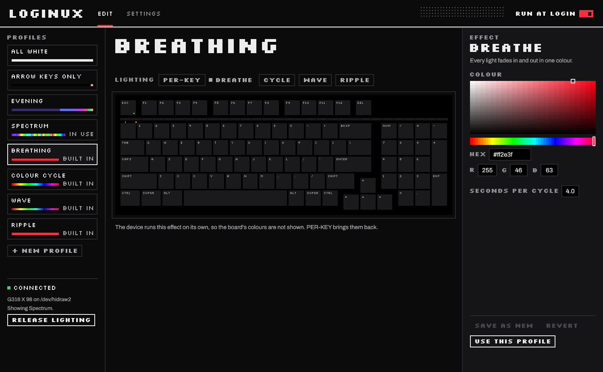

<p align="center">
  
</p>

<h1 align="center">Loginux</h1>

<p align="center">Per-key RGB lighting for Logitech keyboards and mice on Linux.</p>

<p align="center">
  <a href="https://github.com/GbrFrn/loginux/releases/latest"></a>
  <a href="https://github.com/GbrFrn/loginux/actions/workflows/ci.yml"></a>
  <a href="CONTRIBUTING.md#tests"></a>
  <a href="#licence"></a>
  
  
</p>



Paint keys and light bars in a live editor, run the device's own effects, and
keep your profile through replugs and logins. Loginux writes only to the
device's RAM, so unplugging it always brings back the onboard lighting.

## Features

- A live editor: the keyboard follows while you paint.
- Built-in effects: Breathing, Colour Cycle, Wave and Ripple.
- A tray icon to switch profiles and open the editor (KDE Plasma; GNOME with
  the AppIndicator extension).
- Profiles are plain TOML files, and a background service keeps the chosen
  one applied.
- Desktop notifications when the profile or the report rate changes.
- Optional: the light bar as a status line for Claude Code, one share per
  running instance, with its context and your usage limits; a switch under
  SETTINGS connects it ([Claude Code status](docs/usage.md#claude-code-status)).
- A new device is a data file, not code: see [CONTRIBUTING.md](CONTRIBUTING.md).

## Performance

One 17 MB binary is the command line, the background service, the tray icon
and the editor. Measured with v0.1.4 on an Intel Core i7-12700H laptop
(CachyOS, kernel 7.2), with a G316 X 98 reporting at 8000 Hz:

| What | Measured |
| --- | --- |
| Service, idle | 0.05 % of one core |
| Service, memory | 6 MB at its peak by systemd's count, under 3 MB of it its own |
| Service start to lighting applied | 140 ms, finding the keyboard included |
| `loginux status` | 1.1 ms (median of 50), starting the process included |
| Dragging a colour over one key | 60 frames a second, 2 reports a frame; the service 1 to 2 % of one core, the editor 15 to 24 % |
| Dragging a colour over all keys | 60 frames a second, 25 reports a frame; the service 1 to 4 % of one core, the editor 20 to 27 % |
| Editor, open and idle | 0.2 % of one core, 25 MB of memory of its own |
| Editor, one frame | 0.25 to 0.6 ms of CPU |

CPU and memory come from `/proc` and systemd's accounting, and the drags were
measured on the keyboard. While you drag, most of the editor's share goes to
redrawing the window at the display's rate, 240 Hz on this laptop. The frame
times come from `cargo test --release frame_cost -- --ignored --nocapture`.

## Supported devices

| Device | Lighting |
| --- | --- |
| Logitech G316 X 98 | 95 keys and the 30-segment light bar |
| Logitech G903 HERO, on its cable | the logo ([why not the DPI lights](research/g903.md)) |

Loginux drives one device at a time: the one `config.toml` names (see
[Run at login](docs/usage.md#run-at-login)). With a keyboard and a mouse
plugged in, the other device keeps its onboard lighting.

## Install

On Arch Linux, CachyOS and other Arch-based systems (x86_64), download the
package from the [latest release](https://github.com/GbrFrn/loginux/releases/latest)
and install it, or build it from this repository. An AUR package will follow
once AUR registration reopens.

```sh
sudo pacman -U loginux-git-*.pkg.tar.zst            # the downloaded package
# or: git clone https://github.com/GbrFrn/loginux && cd loginux/packaging/aur && makepkg -si
systemctl --user enable --now loginux.service    # keeps a profile applied, shows the tray icon
```

Elsewhere, build it with `cargo install --path .` and add the udev rule:
[install from source](docs/usage.md#install-from-source).

## Usage

Open **Loginux** from the application menu, or run `loginux`.



```sh
loginux use Wave     # keep a profile applied
loginux release      # hand the lighting back and stop keeping a profile
loginux status       # device, profile and settings
```

[docs/usage.md](docs/usage.md) covers the editor, the command line, the profile
format, effects, the service and how Loginux talks to a device.

## Contributing

[CONTRIBUTING.md](CONTRIBUTING.md) explains how to add a device.
[research/](research/README.md) holds the protocol notes and device findings,
each labelled with how it was established.

## Licence

Licensed under either of the [Apache License, Version 2.0](LICENSE-APACHE) or
the [MIT licence](LICENSE-MIT), at your option. The fonts in `fonts/`, and
`src/pixelfont.rs`, which is generated from Silkscreen, stay under the SIL Open
Font License 1.1. Unless you say otherwise, a contribution you submit for
inclusion is licensed as above, without any additional terms.
